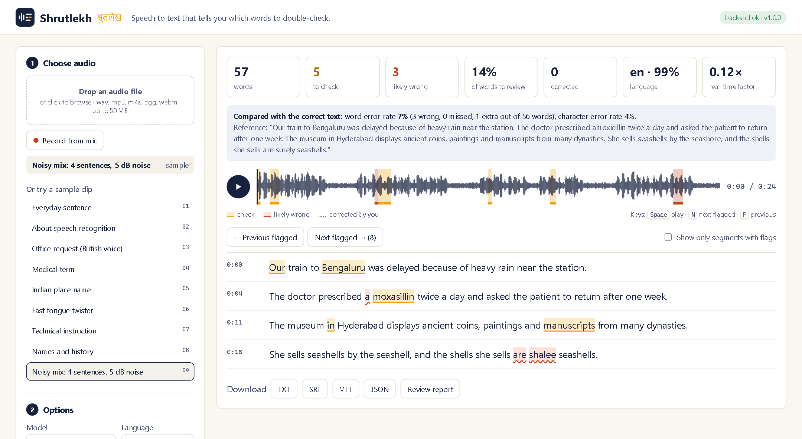
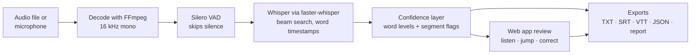

<p align="center">
  <picture>
    <source media="(prefers-color-scheme: dark)" srcset="assets/logo-dark.png">
    
  </picture>
</p>

<p align="center">
  <b>Speech-to-text that tells you which words to double-check.</b><br>
  <a href="#getting-started">Getting started</a> ·
  <a href="#results">Results</a> ·
  <a href="#how-it-works">How it works</a> ·
  <a href="#api">API</a>
</p>

<p align="center">
  
  
  
  
</p>

---

**Shrutlekh** (श्रुतलेख, Hindi for *dictation*) is an Automatic Speech Recognition (ASR) tool built on OpenAI's
Whisper model. Like any speech-to-text tool, it turns audio into a transcript. Unlike most of them, it
does not pretend every word is equally reliable: each word is marked by how sure the model was, so a
person only needs to check the few words that are likely to be wrong instead of re-listening to the
whole recording.

On the included test set, with the `base` model, **Shrutlekh flags about 9% of the words, and those
flagged words contain every recognition error it made** (see [Results](#results)).



*A 25-second clip with background noise. Yellow words are worth a check, red words are probably wrong.
Here, "a moxasillin" should be "amoxicillin" and "are shalee" should be "are surely". The bar above the
transcript shows where the flagged words are in the audio.*

## Features

- **Speech to text** from an uploaded file (wav, mp3, m4a, ogg, webm, flac) or straight from the microphone.
- **Word-level confidence**: every word is classed as *sure*, *check* or *likely wrong*, with adjustable thresholds.
- **Segment warnings** using Whisper's own signals: repeated text (a sign of made-up output), low average confidence, or audio that is probably silence.
- **Review mode**: jump from one flagged word to the next (`N` / `P`), click a word to hear just that word, double-click to correct it.
- **Language**: automatic detection, or force English or Hindi.
- **Three model sizes**: `tiny`, `base` and `small`, all running locally on the CPU with 8-bit weights.
- **Exports**: TXT, SRT and VTT subtitles, JSON with every word's timing and confidence, and a review report listing only the words to check. Corrections made in the app are included.
- **Built-in evaluation**: WER/CER against a reference text, and a benchmark that adds noise at exact SNR levels and measures whether the flags point at the real mistakes.
- **Command line** for scripting, plus a REST API.

## Results

Measured with `python -m shrutlekh benchmark` on the 8 sample clips (121 reference words), CPU only.
Pink background noise was added at each signal-to-noise ratio. Full per-clip output is in
[docs/benchmark.md](docs/benchmark.md).

| Model | Noise | WER | Words flagged | Errors caught by flags (recall) | Error rate in unflagged words | Speed (RTF) |
|---|---|---|---|---|---|---|
| tiny | clean | 7.4% | 16.0% | 66.7% | 2.9% | 0.14 |
| tiny | 10 dB | 5.8% | 16.1% | 85.7% | 1.0% | 0.10 |
| tiny | 0 dB | 19.0% | 34.4% | 68.2% | 8.8% | 0.10 |
| **base** | **clean** | **1.7%** | **9.0%** | **100%** | **0.0%** | 0.21 |
| base | 10 dB | 2.5% | 9.8% | 100% | 0.0% | 0.22 |
| base | 5 dB | 4.1% | 13.2% | 100% | 0.0% | 0.22 |
| base | 0 dB | 10.7% | 25.4% | 91.7% | 1.1% | 0.22 |

What this shows:

- **More noise means more flags.** As the audio gets worse, the share of flagged words rises with the error rate, so the tool asks for more checking exactly when it is needed.
- **Unflagged words can be trusted.** With `base`, no unflagged word was wrong until the noise was as loud as the speech (0 dB).
- **Both models run well under real time.** An RTF of 0.22 means one minute of audio takes about 13 seconds on a laptop CPU.
- **`tiny` is faster but its confidence is less reliable**: it misses about a third of its own errors on clean audio.

**Limits of this test.** The clips are generated with the Windows text-to-speech voices so that the exact
reference text is known. Synthetic voices are cleaner than real people, so real-world WER will be higher.
The test set is also small (121 words). A word can still be wrong with high confidence: in the
screenshot above, "seashore" was heard as "seashell" with 91% confidence.

## How it works



1. **Decoding.** Any format FFmpeg can read is converted to 16 kHz mono, which is what Whisper expects.
2. **Voice activity detection** (Silero VAD, bundled with faster-whisper) removes long silences, which speeds things up and stops Whisper from inventing text in quiet parts.
3. **Recognition.** faster-whisper runs Whisper through CTranslate2 with 8-bit weights. Beam search (width 5) keeps the 5 best partial transcripts at each step instead of only the single best one. `condition_on_previous_text` is turned off so that one mistake cannot repeat through the rest of the recording.
4. **Confidence.** Whisper gives each word a probability. Words at 80% or more are *sure*, 50–80% *check*, and below 50% *likely wrong*. Each segment is also checked against three warning signs: compression ratio above 2.4 (repetitive text), average log-probability below −1.0, and no-speech probability above 0.6.
5. **Review and export.** The web app plays any word on click, steps through flagged words, and lets you fix them. Corrected words count as reviewed, and exports use the corrected text.

### Evaluation method

- **WER** = (substitutions + deletions + insertions) / words in the reference, from a Levenshtein alignment written from scratch in [`metrics.py`](shrutlekh/metrics.py). Text is normalised first (lower-case, punctuation removed by Unicode category so Hindi vowel signs survive).
- **Flag quality.** The same alignment says *which* recognised words are wrong. Each word is then sorted into flagged/unflagged × right/wrong, which gives precision (how many flags were real errors) and recall (how many errors were flagged).
- **Noise** is added at an exact SNR: the noise is scaled so that 10·log10(speech power / noise power) equals the target. Pink noise (more low-frequency energy, like traffic or fans) is the default.

## Tech stack

| Area | Tools |
|---|---|
| Language | Python 3.11 |
| Speech recognition | [faster-whisper](https://github.com/SYSTRAN/faster-whisper) (OpenAI Whisper on CTranslate2), Silero VAD |
| Audio | FFmpeg through PyAV, NumPy |
| Backend | FastAPI, Uvicorn |
| Frontend | HTML, CSS and plain JavaScript (Web Audio API, MediaRecorder), no build step |
| Testing | pytest, FastAPI TestClient |
| CI | GitHub Actions |

## Getting started

**Requirements:** Python 3.10 or newer and about 1 GB of free disk space for the models.
FFmpeg does not need to be installed separately; it comes with PyAV.

```bash
git clone https://github.com/shubhamkr790/Shrutlekh-ASR.git
cd Shrutlekh-ASR

python -m venv .venv
# Windows:      .venv\Scripts\activate
# macOS/Linux:  source .venv/bin/activate

pip install -e ".[dev]"
```

### Run the web app

```bash
python -m shrutlekh serve
```

Open **http://127.0.0.1:8000**, pick a sample clip (or upload a file, or record from the mic) and press
**Transcribe**. The first run downloads the chosen model (tiny ≈ 75 MB, base ≈ 145 MB, small ≈ 480 MB).

You can also open a demo directly: `http://127.0.0.1:8000/?sample=09_noisy_mix.wav&model=base`

### Use the command line

```bash
# colour-coded transcript in the terminal
python -m shrutlekh transcribe samples/09_noisy_mix.wav --model base

# subtitles, or a list of the words to check
python -m shrutlekh transcribe talk.mp3 --format srt --output talk.srt
python -m shrutlekh transcribe talk.mp3 --format md  --output review.md

# Hindi, with stricter flagging
python -m shrutlekh transcribe interview.m4a --language hi --high 0.9 --low 0.6
```

### Run the tests

```bash
pytest              # 53 fast tests, no model download (about 1 second)
pytest -m slow      # 4 end-to-end tests with the real Whisper tiny model
```

### Reproduce the benchmark

```bash
python -m shrutlekh benchmark                      # writes docs/benchmark.md and docs/benchmark.json
python -m shrutlekh benchmark --models base --snr clean 10 0 --noise white
```

To regenerate the sample clips (Windows only, uses the built-in voices):

```bash
powershell -ExecutionPolicy Bypass -File scripts/make_samples.ps1
python scripts/make_noisy_sample.py
```

## API

The web app uses this API, and anything else can too. Interactive docs are at `/docs` while the server is running.

| Method | Path | Description |
|---|---|---|
| `GET` | `/api/health` | Status, available models, languages and export formats |
| `POST` | `/api/transcribe` | Multipart upload: `file`, plus optional `model`, `language`, `high`, `low`. Returns the transcript as JSON |
| `GET` | `/api/samples` | The bundled sample clips and their reference text |
| `POST` | `/api/transcribe/sample/{file}` | Transcribe a sample; the response also includes WER and CER |
| `POST` | `/api/export?format=srt` | Send a transcript (edited or not) and get back `txt`, `srt`, `vtt`, `json` or `md` |
| `GET` | `/api/transcripts/{id}` | One of the last 20 results |

Example:

```bash
curl -F "file=@talk.mp3" -F "model=base" http://127.0.0.1:8000/api/transcribe
```

```json
{
  "language": "en",
  "summary": { "words": 57, "high": 49, "medium": 5, "low": 3, "review_ratio": 0.1404 },
  "segments": [
    { "start": 4.8, "end": 11.0, "text": "The doctor prescribed a moxasillin twice a day ...",
      "flags": [],
      "words": [ { "text": " moxasillin", "start": 6.5, "end": 7.24, "probability": 0.55, "level": "medium" } ] }
  ]
}
```

## Project structure

```
Shrutlekh-ASR/
├── shrutlekh/
│   ├── transcriber.py   # faster-whisper wrapper, model cache, word timestamps
│   ├── confidence.py    # word levels, segment warnings, summary
│   ├── metrics.py       # normalisation, Levenshtein alignment, WER, CER
│   ├── noise.py         # white/pink noise at an exact SNR
│   ├── benchmark.py     # WER and flag-quality evaluation
│   ├── exporters.py     # TXT, SRT, VTT, JSON, review report
│   ├── server.py        # FastAPI app
│   ├── cli.py           # command line (serve, transcribe, benchmark)
│   └── web/             # the web app (index.html, app.js, style.css)
├── samples/             # 9 test clips + references.json
├── scripts/             # sample generation
├── tests/               # 57 pytest tests
├── docs/                # benchmark results, screenshot
└── assets/              # logo
```

## Limitations and next steps

- Whisper's word probabilities are a useful signal but not a guarantee. Some wrong words are still marked as sure.
- Hindi is supported through Whisper's multilingual model, but the benchmark only covers English because no Hindi reference recordings are included yet. Adding real Hindi and Hinglish recordings is the next step.
- `small` is noticeably more accurate but runs at roughly real time on a CPU. A GPU (`device="cuda"`) makes it much faster.
- Long recordings are processed in one request. For hour-long files, streaming partial results would be better.

## Author

**Shubham Kumar** · RA2311003050033

## License

[MIT](LICENSE)
